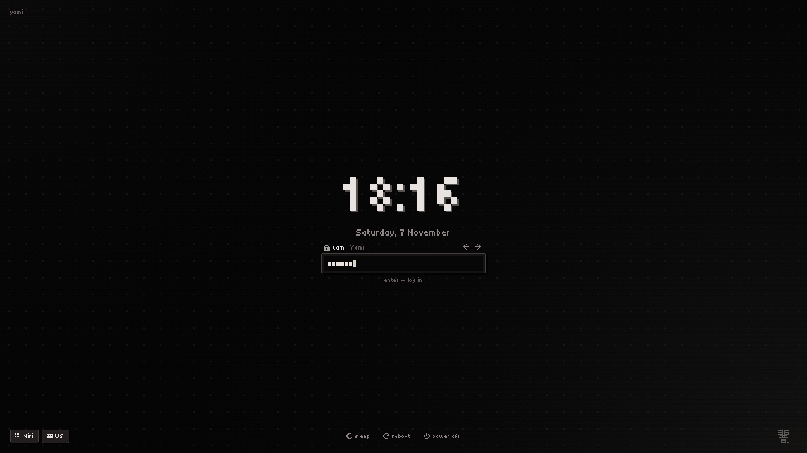

# yami-greet

English · [Русский](README.ru.md)

A login screen: a [greetd](https://sr.ht/~kennylevinsen/greetd/) greeter that draws itself inside
niri with the same pixel face as the yami lock screen: a big clock, your wallpaper under a veil,
the users to pick from, sessions, keyboard layouts and power buttons. The password goes to greetd
only and is wiped from memory right after. Part of the [yami](https://github.com/Trendorin/yami)
desktop, and works on its own with any session listed in `wayland-sessions` (niri, Hyprland, Sway,
KDE, GNOME…).



## What it does

- Starts in tens of milliseconds, a dissolve to black when you log in, and no text flashing on the
  tty in between.
- Every monitor gets the face; the field is on the one with the keyboard. The screens go dark after
  a few idle minutes.
- Remembers who logged in last and with which session.
- Falls back by itself: when the greeter cannot show twice in a row, greetd's text greeter
  (agreety) takes the next login, so a broken driver never locks you out.

## Install

You need greetd and niri from your distribution, Rust 1.89 or newer to build, and sudo:

```sh
git clone https://github.com/Trendorin/yami-greet
cd yami-greet
./install-system.sh
```

It builds as you and asks for sudo once: greetd's config (the old one kept as `config.toml.yami-orig`),
`/var/lib/yami-greet`, the session script `/usr/local/lib/yami/greet-session`, its fonts and the
cursor, and it makes greetd the login manager from the next boot (systemd, OpenRC or runit; without
logind the greeter joins seatd's group). `--no-enable` installs and leaves your login manager alone.

To give the login back to the previous manager: `sudo ./install-system.sh --uninit` (OpenRC, runit),
or with systemd `sudo systemctl enable -f <your old manager>`.

If it ever locks you out: Ctrl+Alt+F3, log in, and enable your previous manager. After two fast
failures agreety comes up by itself.

## Try it without logging out

```sh
yami-greet --demo           # no greetd; the password is «yami», Esc leaves
```

Run inside niri it opens over your session. `yami-greet shot -o DIR` draws every state as PNG
without Wayland. The log of the real thing: `/var/lib/yami-greet/log/greet.log`.

## Look

The greeter runs as greetd's user, so it reads its look from `/var/lib/yami-greet/look/` (root's to
write; the yami shell fills it in by itself):

| File | What |
|---|---|
| `look.json` | the same keys as `~/.config/yami/style.json` (`preset`, `palette` or `accent`, `light`, `corners`, `font`, `lang`, `colors`…) and the ones below |
| `wall.png` | the wallpaper, any size: it covers the screen; none: the theme colour |

| Key | Default | What |
|---|---|---|
| `greetDim` | `0.55` | the veil over the wallpaper (0.2 to 0.9) |
| `greetClock`, `greetHost` | `true` | the big clock and date; the machine name in the corner |
| `greetUsers` | `list` | `list`: pick a user with the arrows; `name`: type the name |
| `greetPower` | `true` | sleep, reboot and power off (where logind or elogind allows) |
| `greetOff` | `2` | minutes before the screens go off; 0: never |
| `greetNumlock` | `true` | numlock on |
| `wallKanji` | `true` | the 闇 glyph in the corner |
| `kbLayout`, `kbSwitch` | empty | keyboard layouts (`us,ru`) and the switch (`grp:alt_shift_toggle`) |
| `outputs` | empty | the text of niri `output` blocks: modes, scales, monitors turned off |

For example:

```sh
echo '{ "preset": "yami", "palette": "ice", "greetUsers": "name", "kbLayout": "us,de" }' |
  sudo tee /var/lib/yami-greet/look/look.json
sudo install -m 644 ~/Pictures/wall.png /var/lib/yami-greet/look/wall.png
```

The greeter reads the files at its next start, with limits on size, and never follows a link there.

## License

MIT
