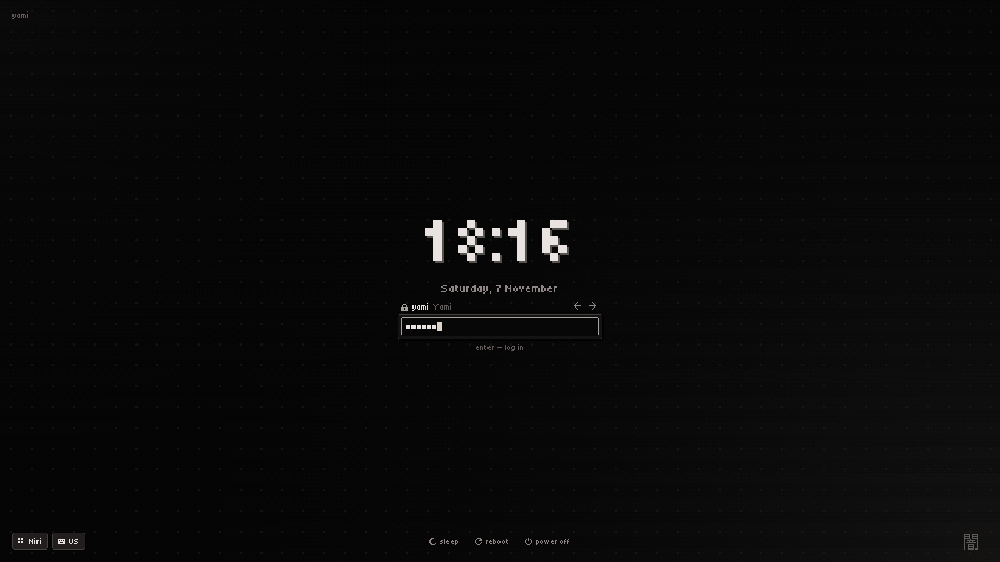

# yami-greet

[English](README.md) · Русский

Экран входа: greeter для [greetd](https://sr.ht/~kennylevinsen/greetd/), который рисует себя внутри
niri тем же пиксельным лицом, что экран блокировки yami: большие часы, твои обои под вуалью,
пользователи на выбор, сеансы, раскладки и кнопки питания. Пароль уходит только в greetd и сразу
стирается из памяти. Часть рабочего стола [yami](https://github.com/Trendorin/yami), которая работает
и сама по себе с любым сеансом из `wayland-sessions` (niri, Hyprland, Sway, KDE, GNOME…).



## Что умеет

- Появляется за десятки миллисекунд, при входе растворяется в чёрный, и никакого текста tty между
  ними.
- Лицо на каждом мониторе; поле ввода — на том, где клавиатура. Через несколько минут простоя
  экраны гаснут.
- Помнит, кто входил последним и в какой сеанс.
- Откатывается сам: если экран входа дважды подряд не смог показаться, следующий вход берёт
  текстовый greeter greetd (agreety), так что сломанный драйвер не запрёт тебя снаружи.

## Установка

Нужны greetd и niri из твоего дистрибутива, Rust 1.89 или новее для сборки и sudo:

```sh
git clone https://github.com/Trendorin/yami-greet
cd yami-greet
./install-system.sh
```

Собирает от твоего имени и один раз просит sudo: конфиг greetd (старый остаётся как
`config.toml.yami-orig`), `/var/lib/yami-greet`, скрипт сеанса `/usr/local/lib/yami/greet-session`,
его шрифты и курсор, и делает greetd менеджером входа со следующей загрузки (systemd, OpenRC или
runit; без logind greeter входит в группу seatd). `--no-enable` ставит и не трогает твой менеджер
входа.

Вернуть вход прежнему менеджеру: `sudo ./install-system.sh --uninit` (OpenRC, runit), а в systemd
`sudo systemctl enable -f <твой прежний менеджер>`.

Если что-то заперло вход: Ctrl+Alt+F3, войди и включи прежний менеджер. После двух быстрых сбоев
agreety поднимается сам.

## Попробовать, не выходя из сеанса

```sh
yami-greet --demo           # без greetd; пароль «yami», Esc — выйти
```

Внутри niri он откроется поверх твоего сеанса. `yami-greet shot -o ПАПКА` рисует все состояния в PNG
без Wayland. Журнал настоящего экрана входа: `/var/lib/yami-greet/log/greet.log`.

## Вид

Экран входа работает от пользователя greetd, поэтому вид он читает из `/var/lib/yami-greet/look/`
(пишет туда root; шелл yami заполняет её сам):

| Файл | Что |
|---|---|
| `look.json` | те же ключи, что в `~/.config/yami/style.json` (`preset`, `palette` или `accent`, `light`, `corners`, `font`, `lang`, `colors`…), и те, что ниже |
| `wall.png` | обои любого размера: они закрывают экран; нет файла — цвет темы |

| Ключ | По умолчанию | Что |
|---|---|---|
| `greetDim` | `0.55` | вуаль над обоями (от 0.2 до 0.9) |
| `greetClock`, `greetHost` | `true` | большие часы и дата; имя машины в углу |
| `greetUsers` | `list` | `list`: пользователь выбирается стрелками; `name`: имя вводится |
| `greetPower` | `true` | сон, перезагрузка и выключение (где logind или elogind разрешают) |
| `greetOff` | `2` | минут до того, как погаснут экраны; 0 — никогда |
| `greetNumlock` | `true` | numlock включён |
| `wallKanji` | `true` | знак 闇 в углу |
| `kbLayout`, `kbSwitch` | пусто | раскладки (`us,ru`) и переключение (`grp:alt_shift_toggle`) |
| `outputs` | пусто | текст блоков `output` niri: режимы, масштаб, выключенные мониторы |

Например:

```sh
echo '{ "preset": "yami", "palette": "ice", "greetUsers": "name", "kbLayout": "us,de" }' |
  sudo tee /var/lib/yami-greet/look/look.json
sudo install -m 644 ~/Pictures/wall.png /var/lib/yami-greet/look/wall.png
```

Экран входа читает файлы при следующем запуске, с ограничением размера, и никогда не идёт там по
ссылкам.

## Лицензия

MIT
